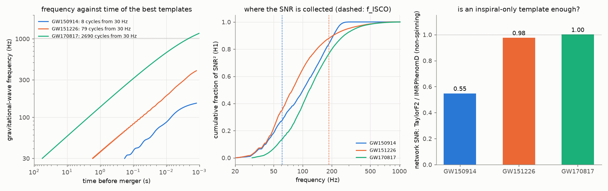
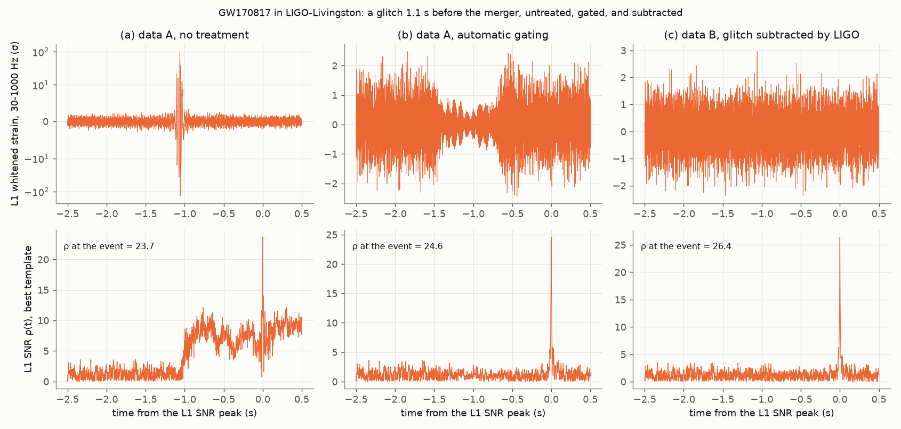

# Three Mergers, Found Again

A known-answer test on public data: a matched-filter search implemented directly with NumPy FFTs is run over LIGO Hanford (H1), LIGO Livingston (L1) and Virgo (V1) strain from the Gravitational Wave Open Science Center (GWOSC), to see whether it finds two black-hole mergers (GW150914, GW151226) and one neutron-star merger (GW170817) without being told when they happened, and whether its numbers match the published ones. This reproduces known detections; it is not a new one. The project is closed at stage 6.

| | GW150914 | GW151226 | GW170817 |
|---|---|---|---|
| Source | binary black hole | binary black hole | binary neutron star |
| Search bank | 496 non-spinning IMRPhenomD, 20–80 M☉ | 1,318 aligned-spin IMRPhenomD, chirp mass 7–13 M☉ | 3,360 non-spinning TaylorF2 (my own), components 1–2 M☉ |
| Time found minus catalogue time | +0.028 s | +0.049 s | +0.047 s |
| Zero-lag coincidences in the event file | 1 (the event) | 1 (the event) | 22 (loudest is the event at 22.69, next 8.29) |
| SNR: H1 / L1 / network | 19.69 / 13.52 / 23.89 | 10.30 / 7.49 / 12.74 | 19.06 / 26.43 / 32.76 (with Virgo 3.32; glitch-subtracted data) |
| Published SNR | 19.5 / 13.3 / 23.6 | 10.5 / 7.9 / 13.0 | 18.8 / 26.4 / 32.4 (Virgo 2.0) |
| Arrival-time difference, L1 first | 7.09 ms (published 6.9) | 1.01 ms (published 1.1) | 3.49 ms (published 3) |
| Chirp mass (bilby) | 30.78 (29.34–32.32) M☉ | 9.709 (9.646–9.772) M☉ | 1.19745 (1.19732–1.19759) M☉ |
| Width of that interval / median | 9.7% | 1.3% | 0.023% |
| Mass ratio | 0.85 (0.66–0.98) | 0.59 (0.26–0.94) | 0.79 (0.66–0.97) |
| Effective spin | −0.04 (−0.15 to +0.06) | +0.20 (+0.13 to +0.38) | −0.000 (−0.011 to +0.019), prior \|χ\| ≤ 0.05 |
| Distance | 447 (264–614) Mpc | 477 (264–653) Mpc | 40.7 (23.1–49.2) Mpc |
| From 30 Hz to merger | 0.18 s, 8 cycles | 1.69 s, 79 cycles | 56.2 s, 2,690 cycles |
| f_ISCO; share of SNR² above it (H1) | 61 Hz; 73% | 186 Hz; 12% | 1,581 Hz; 0% (outside the 1,024 Hz band) |
| Network SNR, TaylorF2 / non-spinning IMRPhenomD | 0.55 | 0.98 | 1.00 |
| Uncorrected leading-order chirp mass / bilby median | 1.25 | 1.02 | 0.987 |
| Background from time slides | 427 years, loudest 9.75 | 107 years, loudest 9.47 | 44.9 years, loudest 9.71 |
| Event statistic; louder background | 23.12; none | 12.50; none | 22.69 (after gating); none |



"Merger" is the amplitude peak of the best template for the two black-hole events and f_ISCO for GW170817. The lighter the system, the longer it stays in band: more cycles fix the chirp mass more tightly, and an inspiral-only template becomes sufficient. Sources: `results/event.json`, `results/event_gw151226.json`, `results/event_gw170817.json`, `results/pe_bilby_<event>.json`, `results/background_ext_<event>.json`, `results/background_GW170817.json`, `results/compare_three.json`.

- Pre-registration (Korean): [docs/PREREGISTRATION.md](docs/PREREGISTRATION.md) for stages 0–4 (GW150914), [docs/PREREGISTRATION_STAGE5.md](docs/PREREGISTRATION_STAGE5.md) for stage 5 (GW151226, extended background, new methods) and [docs/PREREGISTRATION_STAGE6.md](docs/PREREGISTRATION_STAGE6.md) for stage 6 (GW170817). Pass ranges and procedures were committed before the data were downloaded; changes are in the change logs of those files.
- Theory (English): [docs/THEORY.md](docs/THEORY.md). Pipeline and data notes (Korean): [docs/PIPELINE.md](docs/PIPELINE.md), [docs/DATA.md](docs/DATA.md). The Korean documents refer to internal reports that are not part of this repository.
- Masses are in the detector frame unless stated; intervals are 90%.

The question and the rules (known-answer test, ranges before data, event times withheld from the searches, failed checks reported as failures, earlier verdicts left unchanged) are mine. The code was written and run with AI coding agents under my direction; I reviewed each stage. The agents and I knew the published results beforehand; pre-registration guarantees only that procedures and ranges were fixed before this project's own numbers existed.

## What was done

1. The filtering chain in NumPy: median-Welch noise spectrum, whitening, noise-weighted inner product, SNR time series, χ² signal-consistency test, re-weighted SNR.
2. Templates: my own TaylorF2 inspiral phase (3.5PN), which agrees with LALSimulation to within 0.01 rad, and IMRPhenomD waveforms from LALSimulation.
3. Three searches that are not given the event time: 496 non-spinning templates (20–80 M☉) for GW150914, a stochastic bank of 1,318 aligned-spin templates (chirp mass 7–13 M☉) for GW151226, and a stochastic bank of 3,360 non-spinning TaylorF2 templates (components 1–2 M☉, 256 s segments, 30–1,024 Hz) for GW170817.
4. Background from 0.1 s time slides, first on 68 minutes and then on 10.2 hours (GW150914), 5.1 hours (GW151226) and 3.3 hours (GW170817) of data, with an all-pairs estimate, a jackknife over files and a no-reuse distribution.
5. An injection test (900 simulated signals), a leading-order (Newtonian) chirp filter for the chirp mass from the frequency track, aligned-spin parameter estimation with bilby + dynesty (and my own likelihood + emcee as a second route), and a small CNN compared with the matched filter.
6. For GW170817: automatic gating of loud glitches (whitened samples above 50σ are zeroed over ±0.1 s with 0.5 s roll-offs, the same rule on every file, without using the event or glitch time), a coherent three-detector statistic on a sky grid, and bilby parameter estimation with a relative-binning likelihood (IMRPhenomD, aligned low spin, no tides).

## Results

The three-event table is at the top.

**Pre-registered checks.** Stages 0–4: 13 of 15 reproduced. Stage 5: 19 of 20. Stage 6: 23 of 24. Not reproduced:

- **A8** (individual masses of GW150914 from the loudest template): the maximum sat on the equal-mass edge of the grid, 36.0 + 36.0 M☉, 0.2 M☉ outside the range for m2. The search fixes the chirp mass well and the mass ratio hardly at all.
- **A9** (chirp mass from the frequency track by zero crossings): the registered rule returned no measurement in H1.
- **E1** (stage 5, the same question with a leading-order chirp filter, uncorrected): 38.34 M☉ against a range ending at 38.0.
- **J2** (stage 6, L1 SNR after gating divided by the SNR in the glitch-subtracted data): 0.930 against a range of 0.84–0.92. Gating cost 7% of the SNR; the value computed beforehand was 12%.

Stage 5 tested the questions behind A8 and A9 again with new methods under new checks; A8 and A9 stay "not reproduced". With a posterior instead of a grid point, the median masses of GW150914 are 38.5 and 32.7 M☉, inside the range A8 used (F1 reproduced). After a correction measured on 1,000 injections, the chirp filter gives 31.73 ± 0.54 M☉ (E2 reproduced). The full tables with ranges are in the three pre-registration files and in `results/`. Later stages did not change earlier verdicts.

**CNN comparison.** A small 1-D CNN (57,841 parameters) did worse than the matched filter on the same 900 injections at the same false-alarm rate: 31 detections against 272 under the registered procedure, and 111 against 272 in a reference run with a wider coincidence window. This is one small model trained once, not a statement about CNNs in general.

**GW170817 and the glitch.** The GWTC-1 release of L1 has a loud glitch 1.1 s before the merger. The gating rule found it (148σ, 0.007 s from the documented time) and nothing in H1 or Virgo.

| L1 data | SNR | χ² per degree of freedom | Re-weighted SNR |
|---|---|---|---|
| Release as is (glitch present) | 23.68 | 25.2 | 5.29 |
| After automatic gating | 24.59 | 2.59 | 17.00 |
| Release with the glitch subtracted by LIGO | 26.43 | 0.98 | 26.43 |

The search on ungated data still had the event as its loudest candidate (statistic 16.93 instead of 22.69). Virgo's SNR of 3.3 at the expected arrival time is exceeded by 16% of noise-only windows, so Virgo alone does not show the signal; it does shrink the sky area. The 90% area from the matched-filter outputs alone is 659 deg² with H1 and L1 and 16.5 deg² with Virgo added (an approximation without distance or inclination priors); from bilby it is 18.8 deg². The optical counterpart lies inside the last two. Published areas are 28 and 16 deg².



**Chirp mass of GW170817.** Loudest template 1.19741 M☉; leading-order chirp filter 1.1822 uncorrected (1.3% low, as computed beforehand) and 1.19738 ± 0.00007 after correction on 500 injections; bilby 1.19745 (1.19732–1.19759); published 1.1974–1.1976 (low-spin prior). Against the public GWTC-1 samples, the medians of five quantities lie inside each other's intervals, but my chirp mass is 10⁻⁴ M☉ lower and my mass ratio leans lower (0.79 against 0.87).

Figures are in `docs/figures/`, result files in `results/`.

## Reproducing

Python 3.12.

```bash
python -m venv .venv && .venv/bin/pip install -r requirements.txt -r requirements-optional.txt
.venv/bin/python -m pytest                       # 37 unit tests, no data needed (they need lalsuite)
.venv/bin/python scripts/download_data.py        # GWOSC event files for GW150914, with SHA-256
.venv/bin/python scripts/run_search.py           # blind search over 4,096 s (about 10 min)
.venv/bin/python scripts/analyze_event.py
.venv/bin/python scripts/background.py
.venv/bin/python scripts/run_injections.py       # 900 injections (about 35 min)
.venv/bin/python scripts/analyze_injections.py
.venv/bin/python scripts/download_stage5.py      # GW151226 event files and O1 files for the background (3.55 GB)
.venv/bin/python scripts/run_search5.py --help   # stage 5 searches; order and options in docs/PIPELINE.md
.venv/bin/python scripts/make_bns_bank.py        # stage 6: TaylorF2 bank (about 22 min)
.venv/bin/python scripts/download_stage6.py      # GW170817 event files (two releases), O2 files for the background
.venv/bin/python scripts/run_search6.py --start 1187006835   # gated search of the event file (about 13 min)
.venv/bin/python scripts/analyze_gw170817.py
```

The complete order of the stage 5 and stage 6 scripts (searches, backgrounds, bilby runs, CNN) with run times is in [docs/PIPELINE.md](docs/PIPELINE.md). `requirements-optional.txt` holds lalsuite (needed for IMRPhenomD and for the tests), bilby with dynesty < 3, and torch for the CNN. Raw strain, sampler output and model weights are not in this repository. I have not tested a full rebuild on a second machine, and the same data were not run through another search pipeline such as PyCBC.

## Data

All strain data come from GWOSC. The acknowledgement page (gwosc.org/acknowledgement, checked 2026-11-17) states: "Data from this web site are licensed under a Creative Commons Attribution 4.0 International License."

| Data | Identifier | Citation |
|---|---|---|
| GW150914 event files (GWTC-1-confident, v3), H1 and L1, 4 kHz | doi:10.7935/82H3-HH23 | R. Abbott et al. (LIGO Scientific Collaboration and Virgo Collaboration), "Open data from the first and second observing runs of Advanced LIGO and Advanced Virgo", SoftwareX 13 (2021) 100658 |
| GW151226 event files (GWTC-1-confident, v2) | gwosc.org/eventapi/json/GWTC-1-confident/GW151226/v2/ | same |
| O1 4 kHz strain files used for the background | doi:10.7935/K57P8W9D | same |
| GW170817 event files (GWTC-1-confident, v3), H1, L1 and V1, 4 kHz; the L1 glitch is present | doi:10.7935/82H3-HH23 | same |
| GW170817 discovery-paper release (v2), glitch subtracted, 2,048 s | doi:10.7935/K5B8566F | same |
| O2 4 kHz strain files used for the background | gwosc.org/O2/ | same |
| GWTC-1 posterior samples (comparison only) | LIGO DCC P1800370 | B. P. Abbott et al., Phys. Rev. X 9, 031040 (2019). No separate licence statement was found on the DCC page |

Acknowledgement requested by GWOSC:

> This research has made use of data or software obtained from the Gravitational Wave Open Science Center (gwosc.org), a service of the LIGO Scientific Collaboration, the Virgo Collaboration, and KAGRA. This material is based upon work supported by NSF's LIGO Laboratory which is a major facility fully funded by the National Science Foundation, as well as the Science and Technology Facilities Council (STFC) of the United Kingdom, the Max-Planck-Society (MPS), and the State of Niedersachsen/Germany for support of the construction of Advanced LIGO and construction and operation of the GEO600 detector. Additional support for Advanced LIGO was provided by the Australian Research Council. Virgo is funded, through the European Gravitational Observatory (EGO), by the French Centre National de Recherche Scientifique (CNRS), the Italian Istituto Nazionale di Fisica Nucleare (INFN) and the Dutch Nikhef, with contributions by institutions from Belgium, Germany, Greece, Hungary, Ireland, Japan, Monaco, Poland, Portugal, Spain. KAGRA is supported by Ministry of Education, Culture, Sports, Science and Technology (MEXT), Japan Society for the Promotion of Science (JSPS) in Japan; National Research Foundation (NRF) and Ministry of Science and ICT (MSIT) in Korea; Academia Sinica (AS) and National Science and Technology Council (NSTC) in Taiwan.

No strain data are in this repository; `docs/DATA.md` and `data/meta/` list the files with their SHA-256. Result files hold quantities derived from the strain (triggers, SNRs, posterior summaries) and summary statistics of the GWTC-1 samples. Published values used for comparison are from Abbott et al. 2016 (PRL 116, 061102; PRD 93, 122003; PRL 116, 241102; PRL 116, 241103; PRX 6, 041015), Abbott et al. 2017 (PRL 119, 161101) and GWTC-1 (PRX 9, 031040), with the other sources listed in the stage 6 pre-registration, cited with page numbers in the pre-registration files. Software used but not included: LALSuite (GPL-2.0-or-later), bilby, dynesty, PyTorch.

## Limits

- The false-alarm limits (fewer than one per 427, 107 and 44.9 years) are set by a few hours of data, not by the events' real significance; the published limits come from the whole observing run and are not reproduction targets. The tail of the background rests on a few loud triggers.
- The GW151226 search did not know the time but did know the masses: its bank was drawn narrowly around the known result. Its fitting factor is as low as 0.919 in places, and no injection efficiency was measured at these masses. H1 has data for about half of the event file.
- The GW170817 bank is non-spinning, covers only 1–2 M☉ and was built with an O1 noise spectrum; its fitting factor is as low as 0.846 in places (below 0.90 for 0.2% of test signals). The loudest-template chirp mass (K8) sits 10⁻⁵ M☉ inside the lower edge of its range.
- The GW170817 parameter estimation has no tidal terms, starts at 30 Hz (GWTC-1: 23 Hz) and uses gated data. The relative-binning likelihood differs from the exact one by up to 0.5 in log-likelihood on 40 posterior samples (mean +0.03, standard deviation 0.15).
- The sky area from the matched-filter outputs fixes one template and has no distance, inclination or calibration terms; it is not the same quantity as the published area.
- The banks are narrow, coincidences are not required to share a template, and there are no data-quality vetoes.
- The corrected chirp mass from the frequency track (E2) depends on the injection population used for the correction; that dependence and the 1.1 M☉ difference between the corrected H1 and L1 values are not in its quoted uncertainty.
- Parameter estimation uses one aligned-spin waveform model, without precession, higher modes or calibration and noise-spectrum uncertainty; the sampler was run once with one seed.
- The CNN's registered coincidence window was a design mistake (narrower than the CNN's timing scatter); the original result stands and the widened run is a reference only.
- A bug in the peak interpolation, present in stages 0–4, was found and fixed in stage 5 with its original output recorded (`logs/analyze_gw151226_before_fix.txt`). The GW150914 numbers were recomputed and are identical; the other templates of the fine bank were not recomputed.

## Open problems

The project is closed at stage 6; these were left open.

- **Tidal deformability.** The optional run with a tidal waveform (IMRPhenomD_NRTidal) was not done, so there is no limit on Λ̃ here.
- **Cause of J2.** Why gating cost 7% of the L1 SNR instead of the predicted 12% was not investigated. A different shape of the O2 L1 noise spectrum from the O1 spectrum used for the prediction is a candidate, untested. Only one gate width and one threshold were tried.
- Which of the differences (no tides, 30 Hz start, gating, relative binning) moves the GW170817 chirp mass 10⁻⁴ M☉ below the GWTC-1 samples was not separated.

## Licence

Code: MIT (see [LICENSE](LICENSE)). GWOSC data are CC BY 4.0 (above).
